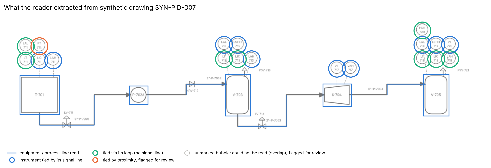
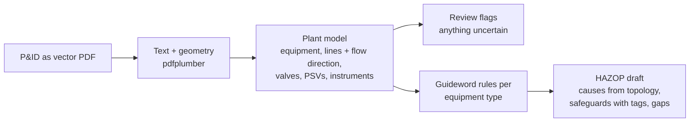
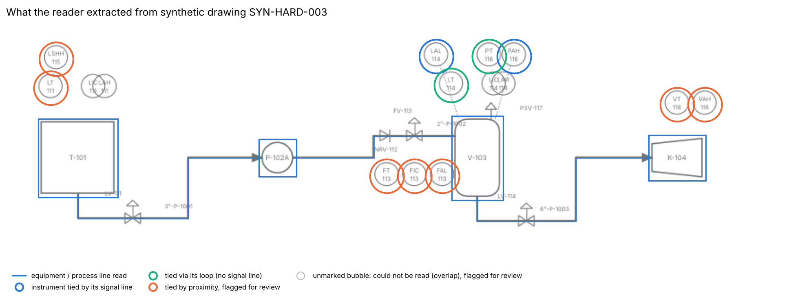

# P&ID to HAZOP scenarios

**Read a P&ID issued as a vector PDF (equipment, lines, flow direction, valves, relief valves, instruments) and turn it into a first-draft HAZOP worksheet. Every safeguard is traced to a tag on the drawing, and every missing safeguard is flagged for the team to discuss.**



## Why it matters

Before a HAZOP or PHA revalidation, someone spends days going through each P&ID: listing the nodes, writing down the likely causes for each guideword, and noting which alarms, trips and relief valves are actually on the drawing. It is slow, and it is easy to miss a node or a missing check valve. Meeting time is expensive, and it is better spent challenging scenarios than transcribing drawings.

This prototype does the transcription. The worksheet it produces is a **starting draft for the HAZOP team**. Severity, likelihood and recommendations stay with the team.

## Approach



**Reading the drawing.** No machine learning is needed for vector drawings. The PDF already holds every text item and every line with exact coordinates, so the reader uses engineering conventions:

| Item | How it is recognised |
|---|---|
| Equipment | ISA-style tag (`V-703`, `P-702A`) inside a closed outline drawn with the equipment line weight |
| Process lines | Thick polylines; ends tied to the equipment they touch; **flow direction from the arrowhead**. With no arrowhead, the reader falls back on the left-to-right drawing convention and flags the line |
| Line numbers, control valves, check valves | Tag grammar (`4"-P-7001`, `LV-711`, `NRV-712`) plus distance to the nearest process line |
| Relief valves | `PSV-` tag, tied to the nearest equipment |
| Instruments | Small circles holding ISA function letters over a loop number (`LIC` / `711`). Each is tied to what it measures by **(1)** its dashed signal line; failing that, **(2)** another instrument of the same loop; failing that, **(3)** proximity, which is always flagged for review |
| Title block | Ignored |

Anything uncertain goes to a `Review_flags` sheet rather than being guessed silently. That covers an instrument tied by proximity, a line with no arrowhead, and overlapping bubbles that can't be paired.

**Drafting the HAZOP.** One node per equipment item (with its inlet line), in process-flow order. For each equipment type, the guideword deviations that apply:

| Equipment | Deviations drafted |
|---|---|
| Tank / drum / column | High level, low level, high pressure, high temperature (when fed by an exchanger or temperature is measured) |
| Pump | No / low flow, reverse flow, high discharge pressure |
| Heat exchanger | High outlet temperature, low process flow, tube leak |
| Compressor | Liquid in suction, high vibration, low flow / surge |

Causes are taken from the drawing's topology (for example, *"LV-713 fails closed"*, *"downstream K-704 stopped"*, *"P-702A deadhead"*). Safeguards list only what is on the drawing, each with its tag and role: alarm and operator response, independent trip, relief, check valve. When an expected protection is missing, a gap note asks the team to look at it. Examples: no high-high level trip, no check valve on a pump discharge, no relief valve, a low-level alarm missing upstream of a pump.

### Excerpt of a generated draft (drawing SYN-PID-007)

| Node | Deviation | Causes (from the drawing) | Safeguards found on the drawing | Gap for team review |
|---|---|---|---|---|
| N01 T-701 (tank) | High level | LV-711 fails closed / LIC mis-set; downstream P-702A stopped | LAH-711 (high-level alarm, operator response) | No independent high-high level trip found on drawing; team to decide if one is needed (LOPA). |
| N01 T-701 (tank) | High pressure | outlet blocked (LV-711 closed); external fire | none found on drawing | No relief valve found on drawing; confirm overpressure protection (may be on another sheet). |
| N02 P-702A (pump) | Reverse flow | pump stops while discharge side is at higher pressure | NRV-712 (check valve) | |
| N03 V-703 (drum) | High level | LV-713 fails closed / LIC mis-set; downstream K-704 stopped; inflow from P-702A above outlet capacity | LAH-713 (alarm); LSHH-715 (independent high-high level trip) | |
| N04 K-704 (compressor) | Liquid in suction | high level in suction drum V-703 | LSHH-715 (trip on suction drum V-703); LAH-713 | |
| N04 K-704 (compressor) | Low flow / surge | downstream blocked | none found on drawing | Anti-surge protection not identifiable from this drawing; team to confirm. |

The full draft has 15 rows. One workbook per drawing is in `outputs/hazop/`, with sheets `HAZOP_draft`, `Drawing_register` and `Review_flags`.

## How it was validated

The drawings are synthetic, and the generator saves the true content of each one. That allows two checks: did the reader extract the drawing correctly, and does the HAZOP draft built from the PDF match the draft built from the true content?

1. **Two drawing sets.** 30 standard drawings, about a third of them "messy" (some signal lines missing, labels nudged). And 20 deliberately **hard** drawings: 70% of signal lines missing, instrument bubbles shifted so they overlap, labels moved well away from their items, and 20% of lines with no arrowhead, half of them stored in reverse order in the PDF.
2. **Every item scored** against the truth: equipment, line connectivity and direction, valves on lines, relief valves, and instrument attachment.
3. **HAZOP drafts compared row by row** (the reader's version against the true-content version): same deviations, same safeguards, same gap call. Every disagreement was checked for direction, because a missed gap matters far more than an extra one.
4. **Unit tests:** tag grammars, geometry, a full drawing against its ground truth, and a small plant whose HAZOP rows were checked by hand, including a test that a missing trip produces a gap rather than a silent pass.
5. **Inspected by eye.** The annotated figures show what was read, how each instrument was tied, and what was flagged.

Building the hard set exposed two real weaknesses, both now fixed: misses on overlapping bubbles were silent, and title-block words were being taken for instrument letters.

## Results on the sample data

| Measure | Standard set (30 drawings) | Hard set (20 drawings) |
|---|---|---|
| Equipment found | 134 / 134 | 98 / 98 |
| Process lines with correct ends and flow direction | 104 / 104 | 78 / 78 (20 had no arrowhead) |
| Valves on the correct line | 80 / 80 | 64 / 64 |
| Relief valves on the correct equipment | 52 / 52 | 42 / 42 |
| Instruments read and tied to the correct item | 435 / 435 | 271 / 323 |
| … of those found, correctly tied | 100% | 98% (5 wrong, all flagged) |
| Instruments missed (overlapping bubbles) | 0 | 47, of which 39 on drawings carrying an overlap warning |
| Review flags raised | 9 (all proximity links, all correct) | 182 |
| HAZOP rows identical to the true-content draft | **440 / 440** | **295 / 319** |
| Gap calls that differ | 0 | 7, **all extra gaps** (a safeguard was missed, so the draft asks about it). **No real gap was hidden** |

**What the numbers do and don't show.** Clean vector drawings that follow consistent conventions can be read exactly. The hard set shows how reading breaks down, mainly on overlapping symbols, and that the reader then errs towards asking the team rather than hiding a gap. These are synthetic drawings in one consistent style. They say nothing yet about real P&IDs from other contractors.



## Limits

- **Vector PDFs only.** Scanned (raster) P&IDs would need OCR and symbol detection, for example a YOLO-type detector trained on ISA-5.1 symbols. That is not covered here.
- **One drawing convention.** Real drawing sets vary by contractor (symbol libraries, tag formats, continuation sheets, interlock notes). Each new convention needs its rules extended and re-checked.
- **One sheet at a time.** Off-sheet connectors are not followed, so a relief valve on another sheet shows as a gap. The gap note says so.
- **The rules are generic.** Process conditions, design pressures, chemistry and operating modes aren't on a P&ID, and the HAZOP team supplies them.

## How to run

```bash
python -m venv .venv && source .venv/bin/activate
pip install -r requirements.txt
python data/generate_pids.py          # optional: drawings and ground truth are already in data/
python run.py                         # read all drawings, score, write HAZOP drafts and figures (~5 s)
pytest                                # unit tests
```

## Repository layout

```
data/generate_pids.py        draws the synthetic P&IDs (PDF + PNG preview) and their ground truth
data/drawings/               30 standard drawings     data/drawings_hard/  20 hard drawings
data/ground_truth/           true content of every drawing (used only for scoring)
src/pid_hazop/reader.py      PDF -> plant model, with review flags
src/pid_hazop/hazop.py       plant model -> HAZOP draft rows
src/pid_hazop/score.py       reading accuracy against ground truth
src/pid_hazop/pipeline.py    runs everything, writes workbooks and metrics
outputs/hazop/               one HAZOP draft workbook per drawing
outputs/metrics.json         all scores    outputs/per_drawing_results.csv  per-drawing detail
```

## Data note

**All drawings in this repository are synthetic,** generated by `data/generate_pids.py` and marked "SYNTHETIC P&ID - NOT A REAL PLANT" in their title blocks. Tags, line numbers, units and layouts are invented. No employer drawings, P&IDs, HAZOP records or plant names were used, and no third-party drawings were copied.

This is a public re-implementation of a personal prototype built on sample data. It has not been deployed at any plant. It produces a draft to support a HAZOP team, not a HAZOP study.

## Credits

Built with Claude Code; design, requirements and validation by Raja (Rajayoganandha Sekaran).

Licence: MIT.
